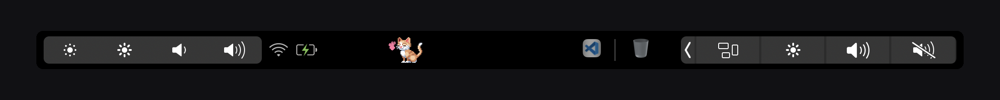

# TouchBarPet

A tiny pixel kitten that lives on your MacBook's Touch Bar. It wanders around, naps when you step away, purrs when you tap it and dashes off when you start typing fast.

Built for **[Pock](https://pock.app)**, the free, open-source Touch Bar manager for macOS. TouchBarPet doesn't change Pock itself. It's a widget that installs into Pock's widget folder and appears on the Touch Bar next to Pock's built-in widgets. In Pock it shows up as **Cat**.

**Author:** Hamza Badar ([@hamzabdr36](https://github.com/hamzabdr36))


On a real Touch Bar, purring after a tap, next to Pock's other widgets:



## What it does

- **Walks and runs** along the Touch Bar on its own, with a mood that changes over time.
- **Naps when you're away.** After a short idle time it closes its eyes and dozes off with little "z"s, then wakes up when you come back.
- **Reacts to touch.** Tap it and it purrs with hearts. Double-tap and it hops. Tap an empty spot and it walks over. Drag your finger and it follows.
- **Notices typing.** Type fast and it swats, then dashes off.
- **Has its own settings page inside Pock:** nap delay, personality (lazy, normal, playful), walking speed, and which reactions to show.
- **Stays light.** It only redraws when the picture changes, and stops completely when the Touch Bar isn't showing it.

## Getting started

Follow these steps to put the kitten on your own Touch Bar. It takes about 10 minutes.

### 1. Check your Mac

You need a MacBook Pro with a Touch Bar, either Intel or Apple silicon, running macOS 11 (Big Sur) or later.

### 2. Install Pock

1. Download Pock from **https://pock.app**.
2. Move **Pock.app** to your **Applications** folder and open it.
3. When macOS asks, allow Pock in **System Settings → Privacy & Security → Accessibility**.
4. Follow Pock's prompt on the Touch Bar to install its default widgets.

Your Touch Bar should now show Pock's widgets, such as the Dock and status icons.

### 3. Install Apple's command line tools

Open **Terminal** and run:

```sh
xcode-select --install
```

Click **Install** in the window that appears. Full Xcode isn't needed. If it says the tools are already installed, you're all set.

### 4. Get the code

```sh
git clone https://github.com/hamzabdr36/TouchBarPet.git
cd TouchBarPet
```

You can also click **Code → Download ZIP** on GitHub, unzip it, and `cd` into the folder in Terminal.

### 5. Get the cat sprites

The artwork isn't included in this repository. Download it free from the artist:

1. Go to **https://xzany.itch.io/cat-2d-pixel-art** (Cat 2D Pixel Art by Mattz Art).
2. Click **Download Now**, then **No thanks, just take me to the downloads**.
3. Download **FREE_Cat 2D Pixel Art.zip**. If you bought the full version, `FULL_Cat 2D Pixel Art.zip` works too.
4. Move the zip into the `TouchBarPet` folder. Leaving it in your Downloads folder also works.

There's no need to unzip it. If you've already extracted it, point the script at the `Sprites` folder instead: `CAT_SPRITES="/path/to/Sprites" ./build.sh --install`.

### 6. Build and install

```sh
./build.sh --install
```

If you see `permission denied` (common after a ZIP download), run `bash build.sh --install` instead.

The script:
- builds the widget (`Cat.pock`) for both Apple silicon and Intel,
- backs up your Pock preferences to `backups/`,
- installs the widget into Pock,
- adds it to your Touch Bar between Status and the Dock,
- relaunches Pock.

### 7. Say hi

The kitten should now be on your Touch Bar. Tap it to pet it, double-tap to make it hop, drag your finger along the bar, type fast, or step away and let it nap.

### Uninstall

```sh
./build.sh --uninstall
```

This removes the widget and takes it off your Touch Bar layout. The rest of your Pock setup stays as it was.

### Update

```sh
git pull
./build.sh --install
```

## Settings

Click the Pock icon in the menu bar, then choose **Widgets → Manage widgets…** and select **Cat**.

| Setting | Options |
|---|---|
| Nap after I'm idle for | 15 s to 5 min, or Never (default 45 s) |
| Personality | Lazy, Normal, Playful |
| Walking speed | 50%–150% |
| Reactions | Swat and dash when typing fast, hearts when tapped, "z"s while napping |

Changes apply right away.

## Troubleshooting

**"Cat sprites not found"**
The script couldn't find the zip. Put `FREE_Cat 2D Pixel Art.zip` in the `TouchBarPet` folder or in Downloads, or point to it directly: `CAT_ZIP="/path/to/the.zip" ./build.sh --install`.

**"Pock.app not found"**
Install Pock (step 2). The script looks in `/Applications`, `~/Applications` and `~/Downloads`. If Pock is somewhere else, run `POCK_APP="/path/to/Pock.app" ./build.sh --install`.

**`xcrun: error` or `swiftc: command not found`**
The command line tools are missing. Run `xcode-select --install` (step 3), then try again.

**The cat doesn't appear on the Touch Bar**
1. Click the Pock icon in the menu bar, choose **Widgets → Manage widgets…**, and check that **Cat** is listed.
2. If it's listed but not showing, open Pock's **Customize Touch Bar** and drag **Cat** onto the bar.
3. Quit Pock and open it again.

**The Touch Bar shows Apple's normal buttons instead of Pock**
Pock is switched to the default Touch Bar. Double-press the **Control** key to switch back, or check Pock's Preferences → "Default Touch Bar shows".

## How it works

- **Swift, AppKit and Core Graphics**, compiled with `swiftc`. The widget is a bundle that Pock loads through its `PKWidget` API, and the settings page uses `PKWidgetPreferences`.
- **Pixel-perfect drawing.** Each sprite pixel is drawn as exactly one point, with interpolation turned off, so the kitten stays crisp.
- **A small behavior state machine** (`CatBrain.swift`) picks what the cat does next from weighted choices that depend on its energy and personality.
- **Idle detection** uses `CGEventSource.secondsSinceLastEventType`, so no extra permissions are needed.
- **Closed eyes** for blinking, purring and napping are generated at load time by finding the eye pixels in the idle frames and recoloring them.

| File | Purpose |
|---|---|
| `Sources/CatWidget.swift` | Widget entry point for Pock |
| `Sources/CatView.swift` | Drawing, timer and Touch Bar touches |
| `Sources/CatBrain.swift` | Behavior state machine |
| `Sources/CatSprites.swift` | Loads and slices the sprite sheets, makes the closed-eye frames |
| `Sources/CatSettings.swift` | Settings stored in Pock's preferences |
| `Sources/CatPreferences.swift` | The settings page shown in Pock |

## Credits

- **Cat sprites:** "Cat 2D Pixel Art" by Mattz Art (free version), https://xzany.itch.io/cat-2d-pixel-art. Used and lightly modified (closed-eye frames) under the artist's license. The sprites aren't included in this repository.
- **Pock and PockKit** by Pierluigi Galdi and contributors, MIT license. Two PockKit interface files are included in `vendor/pockkit` to compile against Pock's widget API.

## License

The source code is released under the MIT license; see [LICENSE](LICENSE). The cat artwork isn't covered by it and keeps its own license.

This project isn't affiliated with Pock or Apple. Touch Bar and MacBook are trademarks of Apple Inc.
